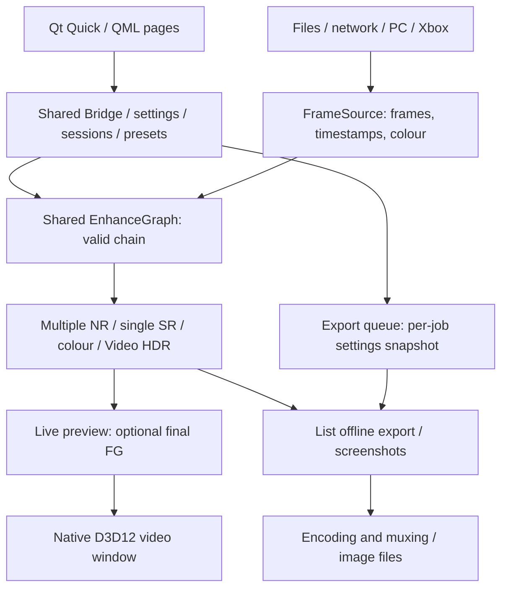

# Veyra

<!-- veyra-creator-and-tutorials:start -->

  <strong>Creator</strong>:
  <a href="https://x.com/likely2002">X · @likely2002</a>
  &nbsp;|&nbsp;
  <a href="https://www.youtube.com/@Likely7Ai">YouTube · @Likely7Ai</a>

<!-- veyra-creator-and-tutorials:end -->

<!-- veyra-main-pr-integration -->
**Veyra — Xbox Series X streaming fork** · fork of [Likely7/Veyra-NRVideo](https://github.com/Likely7/Veyra-NRVideo)

### Real-time GPU video enhancement for Windows

**Super Resolution · Denoising · HDR · Frame Generation · Xbox streaming**

Turn local video, network streams and console streaming into one real-time GPU enhancement pipeline.

> **This is an Xbox-only, English-only fork aimed exclusively at Xbox Series X|S home streaming among console sources.** The PS5 / Chiaki path has been removed entirely. Local files, network streams and PC/Moonlight remain as general video sources. Auto is the default resolution. 1440p is exposed as the ceiling on the native V1 transport but is **provisional**: the wire-level mapping has not been confirmed by a physical capture on this fork. V2 (WebView2) is a 1080p-class engine. See [docs/xbox-1440p-negotiation.md](docs/xbox-1440p-negotiation.md).

 

 

[**⬇ Download Latest Release**](https://github.com/mozoii/Veyra-NRVideo/releases/latest)
&nbsp;&nbsp;·&nbsp;&nbsp;
[**📖 User Guide**](README.md)
&nbsp;&nbsp;·&nbsp;&nbsp;
[**🐛 Report an Issue**](https://github.com/mozoii/Veyra-NRVideo/issues)

 

<i>One engine. Any source. Real-time enhancement.</i>

---

## What this fork is

Veyra is a Windows 11 x64, DirectX 12, Qt 6.8.3 / QML application for real-time GPU video enhancement: local video files, images, network streams and Xbox home streaming share one enhancement pipeline.

This fork:

- **Targets Xbox Series X|S home streaming exclusively as its console source.** PS5 Remote Play and Chiaki are removed entirely (source, UI, CMake blocks, tests, scripts and licenses).
- **Offers resolution modes:** **Auto** (default), **720p**, **720p HQ**, **1080p**, **1080p HQ** and **1440p**, with 1440p as the ceiling on V1.
- **Is English-only.** All first-party UI text, comments and docs are in English.

## Upstream credits

This fork hand-ported the relevant hunks of three pull requests from the original project. No PR branch was merged directly. The full adopted and non-adopted lists are in [docs/UPSTREAM_PR_MERGES_2026-11-23.md](docs/UPSTREAM_PR_MERGES_2026-11-23.md).

- **PR #274** — native-size software H.264 decode and tests, by **SenjuWoo** ([@SenjuWoo](https://github.com/SenjuWoo)). The fork's 1440p tier table and control messages predate this merge.
- **PR #287** — per-frame gamepad physicality, zero touch points, touch-controls decline and tests, by **Kevin** ([@kevinmx21](https://github.com/kevinmx21)).
- **PR #289** — streaming token refresh, keepalive pulse, full Teredo expansion, optional STUN and bitrate cap, RTP NACK/reordering loss recovery with HUD counters, D3D11VA decode option, the settings-load fix and the V2 WebView2 transport, by **RyanBB** ([@RyanLookchard](https://github.com/RyanLookchard)).

The V2 player bundle is a build of [Geocld/XStreaming-player](https://github.com/Geocld/XStreaming-player) (MIT, with the Veyra encoded-export patch); WebView2 is Microsoft's SDK. Licenses and notices are in [THIRD_PARTY_NOTICES.md](THIRD_PARTY_NOTICES.md) and `licenses/xbox/`. Greenlight PR #1752 by iu5gal was researched as a route to 1440p on V2 and was not adopted; the finding is recorded in [docs/WEBVIEW2_1440P_RESEARCH_2026-11-24.md](docs/WEBVIEW2_1440P_RESEARCH_2026-11-24.md).

## Highlights

- **NR controls** — each NR layer's enhancement strength reaches 5. Picture-control defaults off; enable it for Automatic or Manual styles.
- **Rebuilt interface** — Home, Cinema, Professional List, Nodes, Colour, Export and Settings; English source strings with nine translated columns (zh-CN, zh-TW, ja, ko, es, fr, de, pt-BR, ru).
- **Xbox / PC streaming** — unofficial Xbox Series X|S home streaming as the console focus, plus optional Moonlight/Sunshine-compatible PC streaming, local files, images and network streams.
- **Enhancement and compatibility** — DLSS/XeSS/FSR options, streaming improvements and monitoring-overlay compatibility.
- **New export workflow** — editable ordered queue, trimming, MP4/MKV, multiple audio/embedded subtitle tracks, cancellation/retry and completion sound.

## Install and upgrade

Download the latest release from the fork's [releases page](https://github.com/mozoii/Veyra-NRVideo/releases). Run Setup, or extract the portable ZIP with Windows or 7-Zip into a new writable folder and launch **Veyra.exe**. Windows 11 x64 and DirectX 12 are required; Qt and approved runtimes are included, while GPU drivers are installed separately.

Start with effects off, check picture/sound, then enable effects individually. High resolution, layered NR and frame generation increase GPU/VRAM requirements.

## Using Veyra

### Sources and pages

Home offers files, network streams, PC and Xbox streaming. Files/images can also be dropped into the window. Move to the bottom edge to reveal navigation between Home, Cinema, Professional, Colour, Export and Settings.

- Cinema prioritises the picture with a floating source/transport/audio/fullscreen bar, optionally hidden in settings.
- Professional List has Picture, Frame generation, Colour, Sound and Display tabs.
- Click a file's picture to pause/resume; left/right arrows seek five seconds. Double-click or use the fullscreen button.

### Streaming

| Source | Setup |
|---|---|
| Xbox | Sign in with your Microsoft account (device code), select the console, pick the resolution (Auto is default), and connect. Unofficial/experimental; account, service and console restrictions apply. |
| PC | Install/configure Sunshine yourself; discover/add the host, PIN-pair, select app/desktop and connect. Sunshine is not bundled. |
| Network | Open a media URL (HTTP, HTTPS, RTSP) or a server-hosted file. |

**Xbox resolution modes:** Auto (default), 720p, 720p HQ, 1080p, 1080p HQ, 1440p. Auto lets the service pick the best eligible tier. 1440p is the ceiling on the native V1 transport and is **provisional** — see the negotiation notes. The optional V2 WebView2 transport is 1080p-class; selecting 1440p with V2 routes to V1 and the dialog says so. Two software-decoder switches are available (Xbox dialog) for corruption workarounds.

Pausing a stream freezes the preview while keeping the session, not the host game. Physical hardware, networks, HDR and controllers need individual validation.

### Export

Use **List mode**, confirm effects, then open Export. Add/reorder files, edit individual jobs, trim, select MP4/MKV and encoding quality, and keep all or selected audio/subtitle tracks.

### Settings

Screenshot and the preset menu save pictures and personal settings. Settings include language/scale, shortcuts, monitoring GPU, audio devices and component info. Report GPU/driver, media, effects, time and `logs/veyra-qml.log`.

ANR Beta runtime files are user-supplied and **excluded from this public fork** (upstream forbids third-party redistribution of those assets). Supply them yourself alongside the fork if you want the ANR FG path.

## Limitations

- 1440p wire values and tiers are **provisional** pending a physical capture; 1080p and below are the tested path. V2 does not support 1440p and routes that selection to V1.
- Unofficial Xbox support depends on Microsoft's streaming service, which may change without notice.
- 6X upscaling, some NR TDR/VRAM-growth reports and cross-device streaming retain unresolved/unverified cases.
- Submitted FPS is not physical display FPS or end-to-end latency. Frame generation submits a higher rate; the display may or may not show it, and the committed frame pacing is not an end-to-end claim.
- Real-console Xbox long runs still need field retesting.

## Architecture

QML renders UI; native D3D12 renders video. List/Nodes share the engine, disconnected drafts do not execute, and export does not record the preview window.

## Source and build

Original code: GPL-3.0. Chiaki (AGPL-3.0 with OpenSSL exception) has been removed with the PS5 path. Third-party notices: [THIRD_PARTY_NOTICES.md](THIRD_PARTY_NOTICES.md). Proprietary runtimes and models are excluded from source Git.

Developer entry: [docs/README.md](docs/README.md), [build and validation](docs/DEVELOPMENT.md), [UI code responsibilities](docs/ARCHITECTURE.md). Historical task notes are indexed separately.

## Support

Community links belong to the fork's parent project and are kept for reference; this fork does not edit them.

Open source · GPL-3.0 · Windows 11 · DirectX 12 · NVIDIA & AMD

