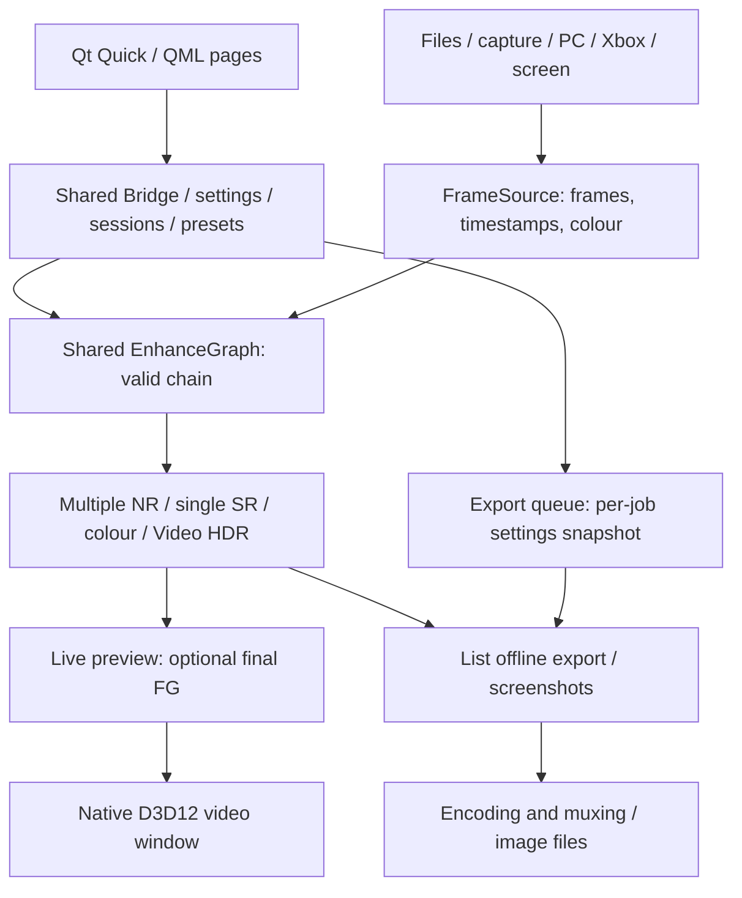

# Veyra

<!-- veyra-creator-and-tutorials:start -->

  <strong>Creator</strong>:
  <a href="https://x.com/likely2002">X · @likely2002</a>
  &nbsp;|&nbsp;
  <a href="https://www.youtube.com/@Likely7Ai">YouTube · @Likely7Ai</a>

<!-- veyra-creator-and-tutorials:end -->

<!-- veyra-main-pr-integration -->
**Veyra — Xbox/English fork** · fork of [Likely7/Veyra-NRVideo](https://github.com/Likely7/Veyra-NRVideo)

### Real-time GPU video enhancement for Windows

**Super Resolution · Denoising · HDR · Frame Generation · Capture · Xbox streaming**

Turn local video, capture cards and game streaming into one real-time GPU enhancement pipeline.

> **This is an Xbox-only, English-only fork.** The PS5 / Chiaki path has been removed entirely. Xbox home streaming is the primary console source, with Auto as the default resolution. 1440p is exposed as the ceiling but is **provisional**: the official wire-level mapping has not yet been confirmed by a physical console capture on this fork. See [docs/xbox-1440p-negotiation.md](docs/xbox-1440p-negotiation.md).

 

 

[**⬇ Download Latest Release**](https://github.com/mozoii/Veyra-NRVideo/releases/latest)
&nbsp;&nbsp;·&nbsp;&nbsp;
[**📖 User Guide**](README.md)
&nbsp;&nbsp;·&nbsp;&nbsp;
[**🐛 Report an Issue**](https://github.com/mozoii/Veyra-NRVideo/issues)

 

<i>One engine. Any source. Real-time enhancement.</i>

---

## What this fork is

Veyra is a Windows 11 x64, DirectX 12, Qt 6.8.3 / QML application for real-time GPU video enhancement: local video files, images, capture cards, screen capture and Xbox home streaming share one enhancement pipeline.

This fork:

- **Removes PS5 Remote Play and Chiaki entirely** (source, UI, CMake blocks, tests, scripts and licenses).
- **Makes Xbox home streaming the primary console source.** Resolution modes: **Auto** (default), **720p**, **720p HQ**, **1080p**, **1080p HQ** and **1440p**, with 1440p as the ceiling.
- **Is English-only.** All first-party UI text, comments and docs are in English.

## Highlights

- **NR controls** — each NR layer's enhancement strength reaches 5. Picture-control defaults off; enable it for Automatic or Manual styles.
- **Rebuilt interface** — Home, Cinema, Professional List, Nodes, Colour, Export and Settings; English source strings with nine translated columns (zh-CN, zh-TW, ja, ko, es, fr, de, pt-BR, ru).
- **PC / Xbox streaming** — Moonlight/Sunshine-compatible PC streaming and unofficial experimental Xbox support, alongside capture cards, screen capture and local files.
- **Enhancement and compatibility** — DLSS/XeSS/FSR options, capture improvements and a persistent OBS Game Capture switch with restart confirmation.
- **New export workflow** — editable ordered queue, trimming, MP4/MKV, multiple audio/embedded subtitle tracks, cancellation/retry and completion sound.

## Install and upgrade

Download the latest release from the fork's [releases page](https://github.com/mozoii/Veyra-NRVideo/releases). Run Setup, or extract the portable ZIP with Windows or 7-Zip into a new writable folder and launch **Veyra.exe**. Windows 11 x64 and DirectX 12 are required; Qt and approved runtimes are included, while GPU/capture drivers are installed separately.

Start with effects off, check picture/sound, then enable effects individually. High resolution, layered NR and frame generation increase GPU/VRAM requirements.

## Using Veyra

### Sources and pages

Home offers files, capture card, PC, Xbox and screen capture. Files/images can also be dropped into the window. Move to the bottom edge to reveal navigation between Home, Cinema, Professional, Colour, Export and Settings.

- Cinema prioritises the picture with a floating source/transport/audio/fullscreen bar, optionally hidden in settings.
- Professional List has Picture, Frame generation, Colour, Sound and Display tabs.
- Click a file's picture to pause/resume; left/right arrows seek five seconds. Double-click or use the fullscreen button.

### Capture and streaming

| Source | Setup |
|---|---|
| Capture card | Select device, resolution, rate, then a supported pixel format and audio input. Close competing apps. Match PQ/HLG/709 and Limited/Full to the signal. Magewell Pro Capture has a dedicated low-latency option. |
| Xbox | Sign in with your Microsoft account (device code), select the console, pick the resolution (Auto is default), and connect. Unofficial/experimental; account, service and console restrictions apply. |
| PC | Install/configure Sunshine yourself; discover/add the host, PIN-pair, select app/desktop and connect. Sunshine is not bundled. |
| Screen | Select a window/display; avoid recursively capturing Veyra itself. |

**Xbox resolution modes:** Auto (default), 720p, 720p HQ, 1080p, 1080p HQ, 1440p. Auto lets the service pick the best eligible tier. 1440p is the ceiling and is **provisional** — see the negotiation notes. Two software-decoder switches are available (Xbox dialog and capture) for corruption workarounds.

**Screen Capture → Game mode** — choose a borderless game window or monitor. Home opens adjustments, Esc closes them, **Ctrl+Alt+Home** exits passthrough. Hotkeys are customizable in Settings → Shortcuts. Windowed game pictures follow the original visible bounds; use borderless fullscreen to fill the display.

Pausing capture/streaming freezes the preview while keeping the session, not the host game. Physical hardware, networks, HDR and controllers need individual validation.

### Export

Use **List mode**, confirm effects, then open Export. Add/reorder files, edit individual jobs, trim, select MP4/MKV and encoding quality, and keep all or selected audio/subtitle tracks.

### OBS and settings

For OBS Game Capture, enable **Settings → General & appearance → OBS Game Capture compatibility**. Screenshot and the preset menu save pictures and personal settings. Settings include language/scale, shortcuts, monitoring GPU, audio devices and component info. Report GPU/driver, media, effects, time and `logs/veyra-qml.log`.

ANR Beta runtime files are user-supplied and **excluded from this public fork** (upstream forbids third-party redistribution of those assets). Supply them yourself alongside the fork if you want the ANR FG path.

## Limitations

- 1440p is **not yet verified** on a physical Series X/S. The tiers and wire values are provisional pending a physical console capture; 1080p and below are the tested path.
- Unofficial Xbox support depends on Microsoft's streaming service, which may change without notice.
- 6X upscaling, some NR TDR/VRAM-growth reports and cross-device streaming retain unresolved/unverified cases.
- Submitted FPS is not physical display FPS or end-to-end latency. Frame generation submits a higher rate; the display may or may not show it, and the committed frame pacing is not an end-to-end claim.
- Real-console Xbox long runs still need field retesting.

## Architecture

QML renders UI; native D3D12 renders video. List/Nodes share the engine, disconnected drafts do not execute, and export does not record the preview window.

## Source and build

Original code: GPL-3.0. Chiaki (AGPL-3.0 with OpenSSL exception) has been removed with the PS5 path. Third-party notices: [THIRD_PARTY_NOTICES.md](THIRD_PARTY_NOTICES.md). Proprietary runtimes and models are excluded from source Git.

Developer entry: [docs/README.md](docs/README.md), [build and validation](docs/DEVELOPMENT.md), [UI code responsibilities](docs/ARCHITECTURE.md). Historical task notes are indexed separately.

## Support

Community links belong to the fork's parent project and are kept for reference; this fork does not edit them.

Open source · GPL-3.0 · Windows 11 · DirectX 12 · NVIDIA & AMD

